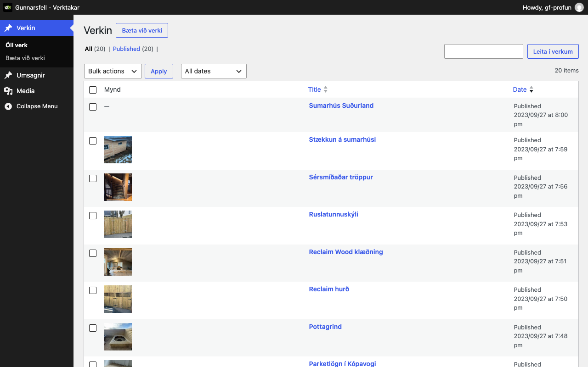
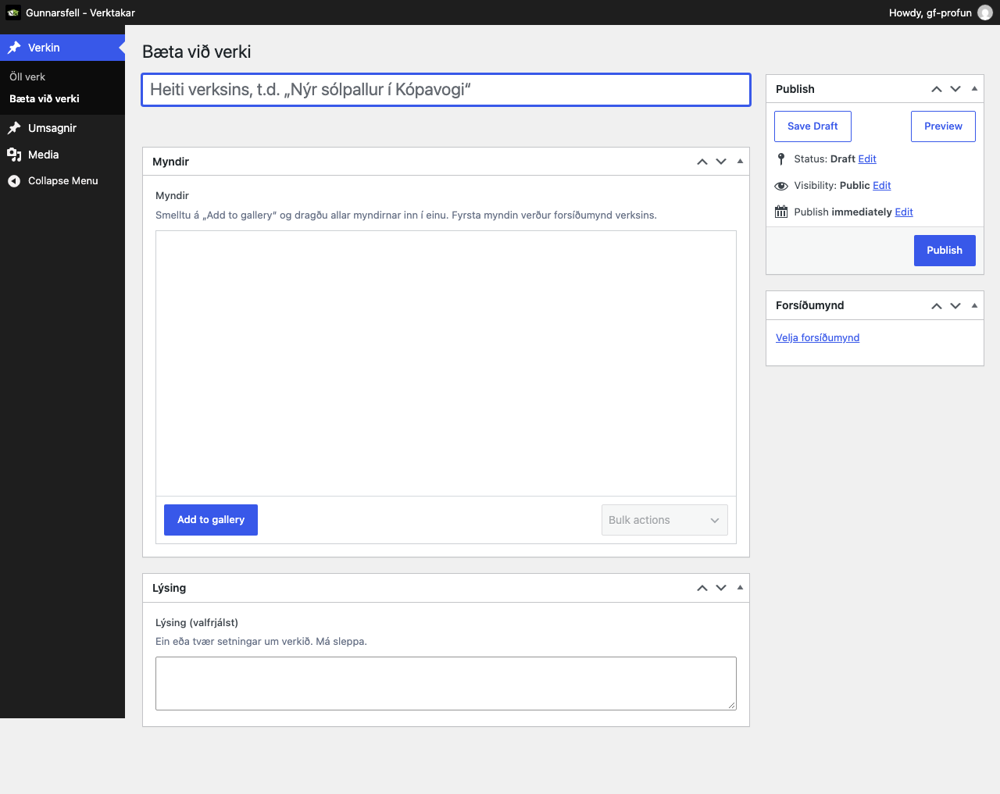
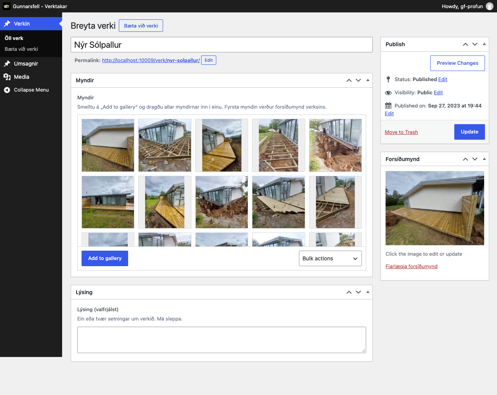

# Að bæta við verki á gunnarsfell.is

Þú þarft bara heiti á verkið og myndirnar. Þetta tekur um tvær mínútur.

## 1. Skráðu þig inn

Farðu á innskráningarsíðu vefsins og skráðu þig inn. Þú lendir beint á listanum **Verkin**.

## 2. Smelltu á „Bæta við verki“

Skrifaðu heiti verksins efst, til dæmis „Nýr sólpallur í Kópavogi“. Heitið birtist á vefnum og í leitarvélum.

## 3. Settu inn myndirnar

Smelltu á **Add to gallery**, veldu allar myndirnar í einu (eða dragðu þær inn í gluggann) og smelltu á **Select**.

- Fyrsta myndin verður forsíðumynd verksins. Dragðu myndirnar til ef þú vilt breyta röðinni.
- Viltu aðra forsíðumynd? Veldu hana undir **Forsíðumynd** hægra megin.
- **Lýsing** er valfrjáls: ein eða tvær setningar um verkið.

## 4. Smelltu á „Publish“

Verkið birtist á síðunni **Unnin verk** og fær sína eigin síðu eftir 1–2 mínútur.

## Að breyta eða eyða verki

Smelltu á verkið í listanum. Breyttu því sem þú vilt og smelltu á **Update**, eða á **Move to Trash** til að taka það af vefnum.
